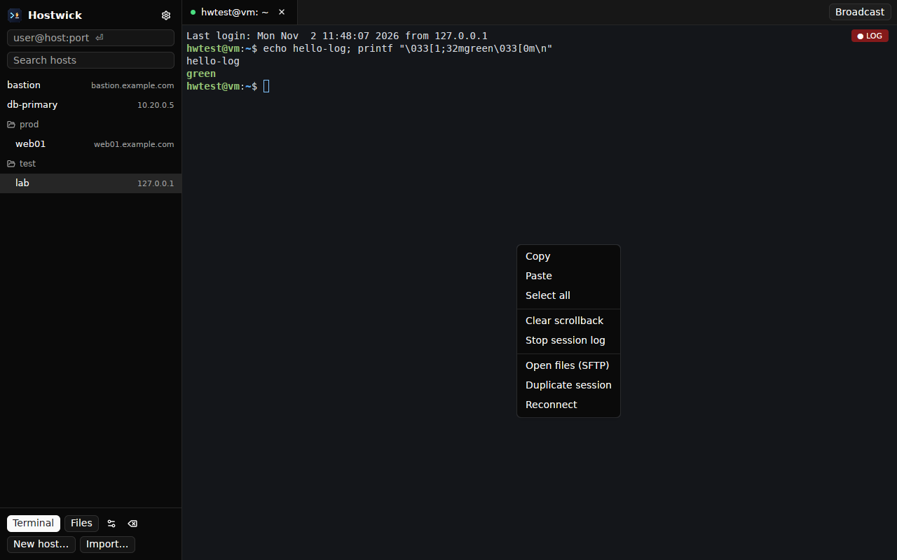
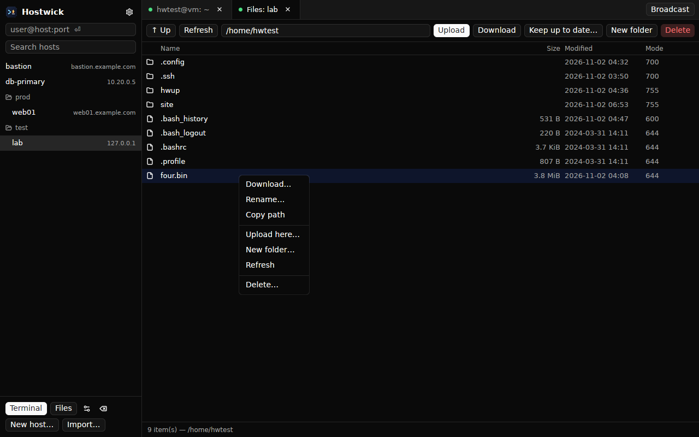

# Hostwick

A fast, reliable SSH terminal, SFTP file manager and tunnel manager in one Rust
app — built to replace Solar-PuTTY, PuTTY and WinSCP on Windows, macOS and Linux.

- **One login per host.** Terminal tabs, the file browser and tunnels share one
  authenticated SSH connection (one host-key check, one MFA prompt).
- **No hangs.** All network work runs on a Tokio runtime, never the UI thread.
  Queues are bounded end to end, every request has a timeout, keepalives detect
  dead links, and terminal output is parsed off-thread with at most one repaint
  per frame.
- **Fast transfers.** 64 SFTP requests in flight per file (like OpenSSH),
  several files in parallel, resumable `.filepart` writes, retries with backoff.
- **Native GPU UI.** GPUI (Zed's UI framework) via `gpui-kit`, with the
  Alacritty terminal core. No webview.
- **Brings your sessions.** Imports `~/.ssh/config`, PuTTY (registry or `.reg`),
  WinSCP (registry or `WinSCP.ini`) and Solar-PuTTY JSON exports.





## Layout

```
crates/
  hostwick-core      domain types (profiles, targets, forwards, backoff) — no I/O
  hostwick-ssh       connection, auth chain, known_hosts, shell/exec, forwards, pool
  hostwick-sftp      RemoteFs port + SFTP and local-disk adapters
  hostwick-transfer  transfer engine: resume, retry, concurrency, rate limit, sync plan
  hostwick-vault     encrypted credential vault (Argon2id + XChaCha20-Poly1305)
  hostwick-store     SQLite profile store with migrations; app paths; portable mode
  hostwick-import    ssh_config, PuTTY, WinSCP and Solar-PuTTY importers
apps/
  cli                `hostwick` command-line client
  desktop            `hostwick-desktop` GUI (GPUI + gpui-component + alacritty_terminal)
tests/fixtures       sample ssh_config, UTF-16 PuTTY .reg, WinSCP.ini
scripts/e2e.sh       throwaway sshd + end-to-end tests
```

Dependencies point inward: apps → adapters → `hostwick-core`. The UI never
touches `russh` directly, which is why the CLI and GUI share all behaviour and
why the transfer engine is tested against two local filesystems.

## Build

Stable Rust (edition 2024; built and tested with 1.97).

```sh
cargo build --release                      # core crates + CLI
cargo build --release -p hostwick-desktop  # GUI
```

Linux GUI builds need: `libxkbcommon-dev libxkbcommon-x11-dev libwayland-dev
libvulkan-dev libfontconfig-dev libfreetype-dev libx11-xcb-dev libxcb1-dev`.
Windows and macOS need nothing extra (the SSH crypto uses `ring`, so no CMake or
NASM).

## CLI

```sh
hostwick ssh admin@10.0.0.5                  # interactive shell
hostwick ssh web -- 'systemctl status nginx' # run a command; exit code is passed through
tar c . | hostwick ssh web 'tar x -C /srv'   # stdin is piped
hostwick ssh -N -L 5432:db:5432 -D 1080 bastion    # tunnels only
hostwick ssh -J ops@bastion db-01            # jump host(s), comma-separated

hostwick cp -r ./site web:/srv/www           # upload (scp semantics)
hostwick cp web:/var/log/syslog .            # download; interrupted copies resume
hostwick cp --existing newer -j 8 --limit 4096 -r src web:dst

hostwick sync ./site web:/srv/www            # WinSCP "Synchronize": copy new/changed files
hostwick sync --delete -x .git -x '*.tmp' ./site web:/srv/www   # mirror: also delete extras
hostwick sync -n --delete ./site web:/srv/www  # dry run: show what would change
hostwick sync --watch ./site web:/srv/www    # "Keep remote directory up to date" (Ctrl+C stops)
hostwick sync web:/var/log/app ./logs        # either direction

hostwick hosts add web 10.0.0.5 -l deploy -i ~/.ssh/id_ed25519 --folder prod
hostwick import putty                        # Windows: reads the registry
hostwick import putty sessions.reg           # anywhere: from `reg export`
hostwick import winscp WinSCP.ini
hostwick import ssh-config

hostwick vault init && hostwick vault set prod-db
hostwick hosts add db 10.0.0.9 --password-credential prod-db
```

`--batch` never prompts (for scripts); `--accept-new` trusts first-seen host
keys but never changed ones.

## Download

Prebuilt Windows, macOS and Linux builds are attached to each
[GitHub Release](https://github.com/meetdhruva/hostwick/releases). Pushing a
`v*` tag — or pushing to the `release` branch, which tags the version from
`Cargo.toml` — builds and publishes them (`.github/workflows/release.yml`).

## Directory sync

Like WinSCP's *Synchronize* and *Keep remote directory up to date*:

- One-way, either direction, files compared by size and modification time
  (copies keep timestamps, so a second run is a no-op).
- `--delete` mirrors: removes destination files and folders missing from the
  source. Without it nothing on the destination is ever deleted.
- `--exclude` globs (`*.tmp`, `.git`, `build/out/*`); excluded files are
  neither copied nor deleted.
- `--watch` polls the source (default every 2 s) and syncs on change. Polling
  works identically on every OS and on network drives; when the source is
  local, sub-second timestamps catch even same-size edits. Errors such as a
  dropped connection are reported and retried, never fatal.
- In the desktop app: **Files → Keep up to date…**, pick a local folder; it
  uploads changes into the current remote folder until you press **Stop sync**
  (never deletes remote files).

## Desktop app

```sh
cargo run --release -p hostwick-desktop
```

Sidebar with saved hosts (folders, search, quick connect), terminal and file
tabs, a transfer queue with progress and cancel, and broadcast input to every
open terminal. PuTTY habits work: selecting copies, right-click pastes;
Ctrl+Shift+C/V (Cmd+C/V on macOS) also work; Shift+PageUp/PageDown scroll.
Host-key, password, passphrase and MFA prompts appear as dialogs.

Terminal font: Consolas (Windows), Menlo (macOS), DejaVu Sans Mono (Linux);
override with `HOSTWICK_FONT="JetBrains Mono"`.

## Security

- Host keys are always verified against `known_hosts` (shared with OpenSSH).
  First-seen keys need explicit trust; a changed key shows a man-in-the-middle
  warning and requires deliberately replacing the saved key.
- Legacy algorithms (`ssh-rsa`/SHA-1 host keys, SHA-1 DH) are off unless a
  profile opts in for old network gear.
- Secrets are `SecretString`s, zeroized on drop, never logged. The vault file
  authenticates its KDF parameters, writes atomically, and is `0600` on Unix.
- Agent forwarding is off by default.
- `russh` ≥ 0.62.5 is required (CVE-2026-73429 and a second fix); this tree
  uses 0.65. Run `cargo deny check` in CI.

## Data locations

`hostwick paths` prints them. Default: the OS data directory plus
`~/.ssh/known_hosts`. **Portable mode:** put an empty `hostwick.portable` file
next to the executable and everything lives in `./data` beside it.
`HOSTWICK_HOME=/some/dir` makes a fully self-contained setup.

## Tests

```sh
cargo test --workspace     # unit + integration tests
scripts/e2e.sh             # starts sshd on 127.0.0.1:2222, runs the e2e suite
```

The e2e suite covers password/key/encrypted-key auth, host-key TOFU and
rejection, PTY shells with resize, `-L`/`-D`/`-R` forwards, jump-host chains,
connection sharing, and a pipelined 24 MiB SFTP round trip.

## What has been verified

- Linux: full test suite, end-to-end suite against OpenSSH, CLI by hand, and
  the desktop app driven under a virtual display (connect, host-key and
  password dialogs, colors/CJK/full-screen apps, a 300k-line output flood,
  broadcast input, file browsing, new folder, delete).
- Windows and macOS: not run yet. The code paths are cross-platform and CI
  builds and tests all three OSes; the Windows-only pieces (Pageant/OpenSSH
  agent pipe, registry importers, console VT mode in the CLI) need a first run
  on a real machine.

## Known gaps / roadmap

- Two-way sync (WinSCP "Both") and remote-side change detection finer than
  one second (SFTP reports whole seconds).

- PuTTY `.ppk` keys are not read directly yet; use Pageant (supported) or
  convert with `puttygen key.ppk -O private-openssh -o key`.
- Agent forwarding is requested but forwarded-agent channels are not served yet.
- The desktop app does not yet unlock the vault (the CLI does); it prompts.
- Terminal mouse reporting (for `htop`/`mc` mouse clicks) and OSC 52 clipboard.
- Legacy SCP (servers without SFTP), FTP/S3 adapters behind `RemoteFs`.
- Native file pickers (upload/download in the desktop app) were not exercised
  headless; the transfer engine behind them is tested.
- Installers (MSI/DMG), code signing and signed auto-update.
